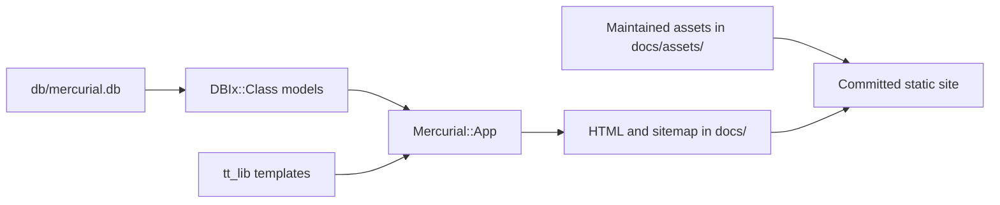

# Mercurial Albums

Mercurial Albums generates the static website at <https://mercurialalbums.com/>:
an independent catalogue of Mercury Prize shortlisted albums and winners,
browsable by year, artist, and album. Visitors can see artwork, read artist
biographies, and follow Amazon purchase or listening links.

The application runs at build time. It reads a local SQLite database through
DBIx::Class, renders Template Toolkit templates, and writes HTML and a sitemap.
The committed `docs/` directory is the GitHub Pages publishing root; visitors do
not need a running Perl application or database server.

This guide records a source and local-data inspection on **22 October 2026**.
See [AGENTS.md](AGENTS.md) for the repository's maintenance instructions. External
services, the live deployment, and shortlist accuracy were not checked during
this inspection.

## Relationship to AGENTS.md

The two documents serve different purposes. [AGENTS.md](AGENTS.md) defines how
maintenance must be performed; this README explains how the application works
and records the inspection evidence. They agree on the core workflow.

| Topic | Overlap or difference |
| --- | --- |
| Shared context | Site purpose, repository layout, canonical database, legacy CSV status, generated output, build command, Perl requirements, sorting, cover metadata, and Amazon-link behavior. |
| Maintenance rules in AGENTS.md | Ordered shortlist/winner update procedure, official-source verification, spelling and artist reuse, cover preparation, required review, file ownership, and preservation of unrelated changes. Use that document for the operational instructions. |
| Explanations added here | Build flow, route and data-model tables, metadata and slug behavior, browser integrations, dependency details, and individual utility behavior. |
| Evidence added here | Dated catalogue counts, build/integrity/cover checks, specific defects, stale routes, and links to follow-up issues. These are inspection results, not permanent invariants. |
| Preview instructions | AGENTS.md gives build/serve commands but omits the asset copy needed in a fresh output directory. The complete preview command below supplies it; the helper and documentation gap is tracked in issue #7. |

The shared introductory context is useful in both entry points. Keep procedural
policy in AGENTS.md and architectural explanations here; use the linked issues
for current maintenance status rather than treating this inspection as a live
backlog.

## Repository map

| Path | Purpose |
| --- | --- |
| `db/mercurial.db` | Canonical production database, including enriched content. |
| `db/mercurial.sql` | SQL schema definition; contains no catalogue data. |
| `db/dbic.conf` | DBIx::Class schema-loader configuration. |
| `lib/Mercurial/App.pm` | Build orchestration, page enumeration, rendering, sitemap. |
| `lib/Mercurial/Schema.pm` | SQLite connection and DBIx::Class namespace loading. |
| `lib/Mercurial/Schema/Result/` | Tables, relationships, URLs, metadata, retail helpers. |
| `lib/Mercurial/Schema/ResultSet/` | Artist and album ordering queries. |
| `lib/Mercurial/Page.pm` | Metadata object for general pages and indexes. |
| `lib/Mercurial/Role/Defaults.pm` | Shared domain, slugs, paths, Open Graph defaults. |
| `lib/Mercurial/Sort.pm` | Shared artist-name and album-title sort normalization. |
| `tt_lib/` | Page templates, shared layout, Amazon-button macros. |
| `bin/` | Build, preview, import, enrichment, and text-repair utilities. |
| `docs/` | Generated pages alongside maintained static assets and hosting files. |
| `albums.csv` | Legacy historical import seed; leave unchanged. |
| `mercurialalbums.db` | Empty root-level file; **not** the production database. |

## How a build works



`bin/build_site` accepts `--db` and `--out`, constructs `Mercurial::App`, and calls
`run`. The application's defaults are the production database relative to the
entry-point script and an output directory named `docs`.

`Mercurial::App` selects the highest numbered year for the homepage feature,
then writes these routes:

| Route | Content and ordering |
| --- | --- |
| `/` | Introduction and latest shortlist, with covers ordered by title. |
| `/year/` | Years, newest first. |
| `/year/<year>/` | Shortlist, winner first and then normalized album title. |
| `/artist/` | Artists ordered by normalized name. |
| `/artist/<slug>/` | Biography and nominated albums in ascending prize-year order. |
| `/album/` | All albums ordered by normalized title. |
| `/album/<slug>/` | Artwork, artist, prize year, winner badge, retail/listening links. |
| `/about/`, `/contact/`, `/privacy/` | General information pages. |
| `/404.html` | Custom error page, omitted from the sitemap. |

Every template uses `layout.tt` as a wrapper and `utils.tt` as a preprocessor.
The layout selects the page/year/artist/album object for metadata and navigation.
`MooX::Role::SEOTags` provides canonical, Open Graph, and Twitter tags;
`MooX::Role::JSON_LD` supplies structured data for artists, albums, and years.
The generator writes UTF-8, tidies whitespace, and normalizes some metadata
attribute ordering to keep output stable.

URLs use the hardcoded production domain. Slugs lowercase and transliterate
names/titles, remove apostrophes, and collapse other punctuation to hyphens;
`÷` has an explicit `divide` special case. Album slugs use only the title.
Sort values separately trim/collapse whitespace, remove a leading whole-word
English article (`a`, `an`, `the`), and lowercase the result.

The sitemap contains each generated public page URL except the 404, with the
build date as every entry's `lastmod`. It does not track individual content
modification dates. The layout also derives its copyright year at build time.

## Data model

| Table | Main fields and relationships |
| --- | --- |
| `year` | Unique prize year, optional winner announcement date. Has many albums. |
| `artist` | Unique name, normalized sort name, biography (`blurb`). Has many albums. |
| `album` | Title, artist/year foreign keys, winner flag, sort title, optional blurb, cover filename and source URL. Unique on `(title, artist_id)`. |
| `album_retail_link` | Album foreign key, retailer, country, link type, ASIN and/or URL. Unique on `(album_id, retailer, country, link_type)`. |

The schema connection enables foreign keys and configures SQLite Unicode
handling. Result classes combine generated DBIx::Class declarations with custom
methods below the schema-loader boundary. Schema changes need to keep the SQL,
live database, and result classes synchronized; there is no migration framework.
Winner flags are maintained operationally: the database does not enforce one
winner per year.

Artist biographies are displayed as escaped plain text with preserved line
breaks. The album `blurb` column exists but is not rendered by `album.tt`.
Album cover filenames are explicit data, independent of retail ASINs. Their
source URLs preserve provenance; the renderer uses local files in
`docs/assets/albums/`.

Amazon buttons prefer a GB product ASIN, then a stored Amazon Music stream URL,
then an encoded Music search for the album and artist. Album pages with a product
also show a listening/search button. Product anchors are enhanced in the browser
by the external AmazonStore script, with affiliate tag `davblog-21`; the raw
product anchors have no `href`. The separate Music Unlimited trial link also
includes that tag. Per the maintenance guide, streams themselves do not earn
affiliate income.

The shared layout loads Google Analytics, AdSense, and AmazonStore. Contact uses
an embedded Google Form. Local styling is plain CSS in `docs/assets/site.css`;
there is no frontend build step. `docs/CNAME`, `.nojekyll`, `ads.txt`, artwork,
and CSS are maintained files that the Perl build does not create.

## Building and previewing

Run commands from the repository root. Perl **5.40 or newer** is required by the
native class syntax in `Mercurial::App`. Dependencies are locally installed;
there is no `cpanfile`, lockfile, or other dependency manifest. The main build
uses DBIx::Class (including Schema::ResultSetNames and InflateColumn::DateTime),
DBD::SQLite and date support, Template Toolkit, Moose/Moo and their supporting
modules, MooX::Role::SEOTags, MooX::Role::JSON_LD, Text::Unidecode, and URI::Escape.

Build the publishing directory after changing data or templates:

```sh
PERL5LIB=lib bin/build_site --db db/mercurial.db --out docs
```

For an isolated preview with working artwork and styles:

```sh
preview_dir=$(mktemp -d /tmp/mercurialalbums-preview.XXXXXX)
PERL5LIB=lib bin/build_site --db db/mercurial.db --out "$preview_dir"
cp -a docs/assets "$preview_dir/assets"
python3 -m http.server 8000 --directory "$preview_dir"
```

Open `http://localhost:8000/`. A fresh build writes HTML and XML only; the asset
copy is necessary for a complete preview. `bin/dev` builds and serves through
`http_this` or Python on port 8000, but does not copy assets. Its default database
is the empty root-level file, so always pass `db/mercurial.db` explicitly.

Builds overwrite the pages they enumerate but **do not delete obsolete pages**.
Renaming an artist/album can therefore leave an old route in `docs/`; inspect the
diff and stale files when changing names. The build also assumes at least one
year exists, dereferencing the latest year before rendering the homepage.

## Maintenance utilities

These are standalone scripts with different defaults. Several write directly to
the production database; inspect them and back up the database before use.
Routine shortlist maintenance should follow [AGENTS.md](AGENTS.md), updating the
enriched database directly and rebuilding rather than reimporting the CSV.

| Script | Behavior and caveats |
| --- | --- |
| `add_album_sort_title [DB]` | Backfills both artist and album sort values in a transaction. Defaults to the production database. |
| `edit_blurb ARTIST_ID` | Opens a biography using `$EDITOR` (default `vi`), normalizes Unicode/NBSP, and saves it transactionally. |
| `check_mojibake` | Read-only heuristic scan for broken encoding in artist biographies. |
| `fix_mojibake` | Writes CP1252/UTF-8 repairs to matching biographies in a transaction. |
| `fix_mojibake2 --dry-run` | Scores several encoding/entity repairs. Dry-run rolls back by throwing an exception and exits unsuccessfully. Its usage text advertises `--db`, but that option is not implemented. |
| `mb2asin` | Queries MusicBrainz, scores releases by artist/title, country, date and ASIN, then stores product links. Supports `--db`, `--artist`, `--limit`, `--sleep`, and `--dry-run`. Always start with dry-run. Skips albums with **any** existing Amazon GB link, including a stream. No minimum match-score cutoff. Uses `MB_CONTACT` and optional `AMAZON_ASSOCIATE_TAG`. |
| `mkblurb` | Requests biographies for up to 20 artists whose blurb is undefined and writes them immediately. Requires `OPENAI_API_KEY` and OpenAPI::Client::OpenAI. No dry-run; not part of the site build. |
| `get_data` | Historical Wikipedia-to-CSV scraper. Delimiter parsing is fragile; not an authoritative import source. |
| `load` | Historical four-column CSV import using `find_or_create`; updates sort values but does not refresh existing winner flags or enriched fields. |
| `mkasin` | Imports album IDs/ASINs, skips existing product links, and sets ASIN-based cover metadata without downloading artwork. Can overwrite explicit cover metadata. |
| `get_images` | Downloads Amazon images for every album with an ASIN, pads/resizes using ImageMagick `magick`, and overwrites ASIN-named covers and cover metadata. Legacy bulk tool; inspect before using on enriched data. |

Network access and optional utility dependencies are unnecessary for a normal
site build. The tools use additional modules such as LWP::UserAgent, Web::Query,
Data::Printer, JSON::MaybeXS, HTML::Entities, and Unicode::Normalize.

## Inspection results and outstanding issues

The following describe the checked-in data and code as inspected on 22 October
2026, rather than an independently verified history of the prize:

- **35 years (1992–2026), 318 artists, 408 albums.** Every artist has a biography;
  no album has a blurb. Each year through 2025 has one winner; 2026 has none and
  stores announcement date `2026-10-22`.
- **397 product links and 12 stream links**, all Amazon GB. An album may have
  both types, so these are link counts rather than distinct album counts.
- SQLite `integrity_check` returned `ok`; `foreign_key_check` returned no rows.
  Every artist/album has a nonempty sort value. All 408 covers exist under
  distinct filenames, have recorded source URLs, and measure exactly 500×500.
- A clean build using local Perl 5.42.3 produced **769 HTML files and 768 unique
  sitemap URLs**. Every generated HTML file exactly matched its committed
  counterpart. All local HTML `href`/`src` references resolved when checked
  against the fresh pages and existing `docs/assets/`. No current slug collisions
  were found. These checks do not validate external URLs or browser behavior.
- `docs/` contains **four stale HTML pages** outside the current build's routes:
  `album/a/`, `album/actual-life-3-january-1/`,
  `album/gorillaz-nomination-withdrawn-at-the-request-of-the-band-50/`, and
  `artist/maxa-mo-park/`. They were left in place during inspection.
- **Schema drift:** the live `album_retail_link` table checks that `link_type`
  is `product`, `stream`, or `search`; `db/mercurial.sql` omits that check.
- **Album image alternative text:** `tt_lib/album.tt` uses unscoped `title` and
  `artist.name` instead of `album.title` and `album.artist.name`. For example,
  the Brat page renders `alt="Cover of Mercurial Albums by "`.
- **Mobile CSS typo:** `docs/assets/site.css` contains
  `grid-template-columns: i48px 1fr` in its narrow-screen rule. That value is
  invalid CSS and prevents that declaration from applying.
- **Future title collisions:** albums are unique by title and artist in SQLite,
  but output paths use title alone. Two artists with the same album title would
  overwrite the same HTML file. There is no collision check in the generator.

There is no automated test suite or checked-in CI workflow. Current verification
is build-based, supported by database queries and review of generated HTML and
the complete diff. Inspection only added this document; application code,
production data, generated pages, and pre-existing untracked CSV files were
left unchanged. New or modified maintenance files must remain owned by
`dave:dave`.

The maintenance findings are tracked on GitHub. Each issue records the source
evidence, impact, and acceptance criteria; no fixes were applied during this
inspection or documentation comparison.

| Issue | Follow-up |
| --- | --- |
| [#2](https://github.com/davorg/mercurialalbums/issues/2) | Correct album cover alternative text. |
| [#3](https://github.com/davorg/mercurialalbums/issues/3) | Fix the invalid mobile grid declaration. |
| [#4](https://github.com/davorg/mercurialalbums/issues/4) | Synchronize the retail link-type constraint. |
| [#5](https://github.com/davorg/mercurialalbums/issues/5) | Review stale pages and detect obsolete output. |
| [#6](https://github.com/davorg/mercurialalbums/issues/6) | Detect output-path collisions. |
| [#7](https://github.com/davorg/mercurialalbums/issues/7) | Repair development preview defaults and assets. |
| [#8](https://github.com/davorg/mercurialalbums/issues/8) | Fix the encoding-repair CLI's database and dry-run handling. |
| [#9](https://github.com/davorg/mercurialalbums/issues/9) | Enrich product links for albums that already have streams. |
| [#10](https://github.com/davorg/mercurialalbums/issues/10) | Reject weak MusicBrainz matches. |
| [#11](https://github.com/davorg/mercurialalbums/issues/11) | Preserve curated covers in legacy utilities. |
| [#12](https://github.com/davorg/mercurialalbums/issues/12) | Declare dependencies and provide a reproducible build check. |

The existing [biography sourcing issue #1](https://github.com/davorg/mercurialalbums/issues/1)
was checked before filing these issues and remains separate.
